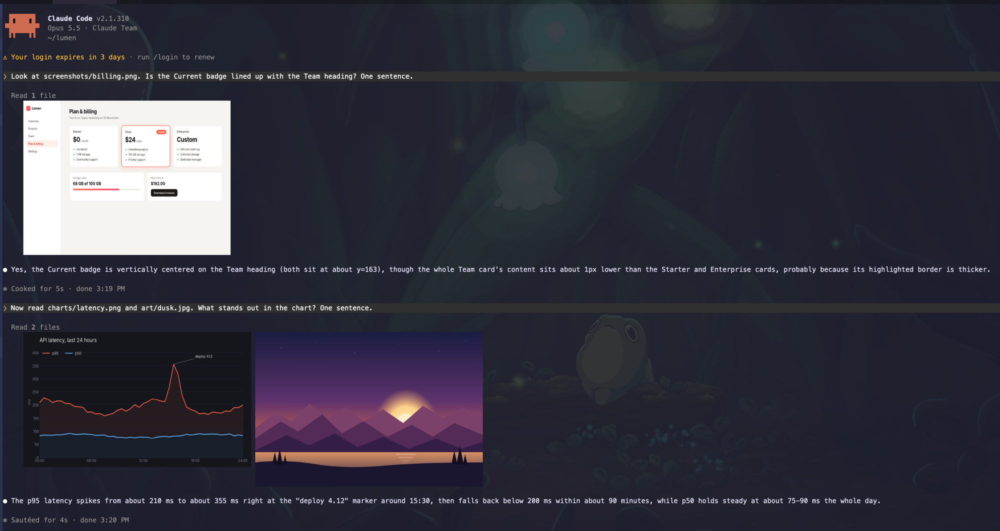

# inline-images

A Claude Code mod that draws images right where they live in the conversation.



- **Images Claude's tools return** show under that tool's row: a screenshot, a chart or a photo it reads.
- **A collapsed group** such as `Read 2 files` shows all of its images side by side, and they stay put when you click the group open.
- **Images you paste** show under the prompt that carried them, in place of a bare `[Image #1]`.

The images come from the tool results themselves, so what you see is exactly what Claude saw.
Nothing is read from disk except your own pastes.

## Examples

The screenshot above comes from two prompts:

```text
> Look at screenshots/billing.png. Is the Current badge lined up with the Team heading?
> Now read charts/latency.png and art/dusk.jpg. What stands out in the chart?
```

- `billing.png` is a web app screenshot, drawn under `Read 1 file`.
- `latency.png` and `dusk.jpg` are read together, so they share one `Read 2 files` row.
- `dusk.jpg` is a JPEG: the mod converts it to PNG for the terminal.

Other places it helps:

- Playwright or Chrome DevTools screenshots while Claude checks a UI change.
- Plots from a notebook or a data script that Claude reads back.
- A design mockup you paste before asking for an implementation.

## Requirements

- Claude Code 2.1.287 or later, where mods are on by default.
- A terminal with the kitty graphics protocol: kitty, Ghostty, WezTerm, or a multiplexer that passes it through, such as Herdr.
- ImageMagick (`magick`) for JPEG, WebP, GIF and large PNG images. Small PNG images need nothing.

Claude Code only draws pictures in terminals it recognises by name.
In any other terminal that speaks the kitty protocol (Herdr, WezTerm, a Ghostty-based app), turn them on in `~/.claude/settings.json` and start a new session:

```json
{ "env": { "CLAUDE_CODE_FORCE_TERMINAL_IMAGES": "1" } }
```

Without it, each picture shows its alt text, `[image]`.

## Install

At the prompt of a Claude Code terminal session:

```text
/plugin install inline-images --marketplace SergioGhisler/cc-inline-images-mod
```

Answer `y` to add the marketplace, then press Enter to install at the user scope.

From a shell:

```sh
claude plugin install inline-images --marketplace SergioGhisler/cc-inline-images-mod
```

In the desktop app, where `/plugin` does not run: click **+** next to the prompt box, then **Plugins**, **Add marketplace** with `SergioGhisler/cc-inline-images-mod`, then **Add plugin**.

## How it works

- It hooks the transcript's `ToolResult`, `ToolUse` and `ToolGroup` rows and finds every image block in the tool's output: the `Read` tool's own record, and MCP image content.
- Pasted images come from the folder where Claude Code saves them, `<tmp>/claude-<uid>/<project>/<session>/images/<n>.png`.
- A PNG of at most 1024 px is drawn as is. Anything else goes through ImageMagick once, down to 1024 px on its long side, and is kept in memory for the session.
- Each picture is sent as PNG bytes, never as a file path, so it also works when the terminal runs on another machine over SSH.
- Sizes are the `MAX_COLUMNS` and `MAX_ROWS` values at the top of `hooks/pictures.ts`, in terminal cells.

## Develop

```sh
claude plugin validate .
claude plugin test .
CLAUDE_CODE_FORCE_TERMINAL_IMAGES=1 claude --plugin-dir .
```

## License

[MIT](LICENSE)
